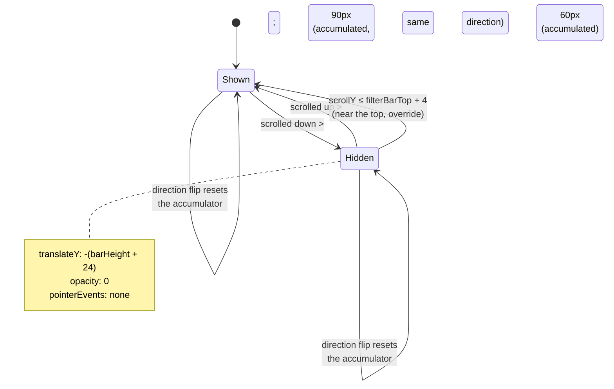

# 2026-08-31 — Reskinning `/companies` to the "Companies.html" design

## What changed

`app/companies/index.tsx` went from a filtered, virtualized `FlatList` of company
cards to a landing-styled page: hidden global header + reused `LandingNavbar`, a
hero with a metallic headline, a restyled filter bar that sticks and hides on
scroll, restyled cards, infinite scroll, and a mini footer. New components live in
`components/companies/`. Shared pieces touched: `CompanyCard`, `FilterTag`,
`FavoriteHeartButton` (new optional props), `FlagCdn` (bug fix), `theme/colors.tsx`
and `constants/layout.ts` (new tokens), plus a new `theme/companies.ts`.

The behavioural shifts that outrank the styling: **filters no longer remove
companies — they reorder**, the list is **no longer virtualized**, and the page
**suppresses the app's global header**.

## The decisions that mattered

### 1. Should a filter hide non-matching companies, or just push them down?

**The problem:** you asked, explicitly, that no filter ever hide an audition —
matches should just come first. That inverts what "filter" normally means and it
interacts with pagination and with the empty state.

**What we did:** `orderedCompanies` (the `useMemo` around line 205 of `index.tsx`)
partitions `allCompanies` into `matches` (pass every active predicate — search,
country, favourites, date) and `rest` (everything else), orders each partition,
and concatenates: `[...orderedMatches, ...orderedRest]`. It also returns
`matchCount`, which is the **index where the divider goes** and where the
paginated slice switches from "matched" cards to "other" cards. The UI renders
`renderGrid(visibleMatches)` then an `OTHER COMPANIES` rule then
`renderGrid(visibleRest)`, but only once the visible slice has actually reached
past `matchCount`.

**Why this and not something else:** the alternative was to keep real filtering
and add a "show all" escape hatch, or to use a `SectionList` with sticky section
headers. Concatenate-and-split won because it kept one flat scroll with one
pagination counter and one infinite-scroll trigger; a `SectionList` would have
meant two independent paginations. The cost is named below.

**What breaks it:** the `useMemo` runs `fuse.search` + two full `Array.filter`
passes + up to two sorts over ~396 items on **every keystroke** (the search text
is `useDeferredValue`-wrapped so it's off the critical path, but it still runs).
Never profiled. And `matchCount` is only meaningful because JS `Array.sort` is
stable and the two partitions are disjoint — if that invariant ever broke, the
divider would land in the wrong place.

### 2. Why does infinite scroll need a latch ref instead of just `setPage(p => p + 1)`?

**The problem:** `onScroll` fires roughly every frame while the finger is moving.
The load trigger is "viewport is within 900px of the end".

**What we did:** `loadMoreLatch` (a `useRef(false)`). On entering the trigger
zone: if `hasMore && !loadMoreLatch.current`, set the latch and bump the page.
On leaving the zone: clear the latch. So one page-bump per approach.

**Why this and not something else:** without the latch, `setPage(p => p + 1)`
gets called on every scroll event while you're near the bottom. React batches
those, but **functional state updaters compose** — five queued `p => p + 1` calls
before the next render apply as `+5`. You'd skip four pages of companies. A
debounce would also work but adds a timer to reason about; a ref latch is
synchronous and self-documenting.

**What breaks it:** if the content is shorter than the viewport + 900px (few
companies, or all filters cleared on a huge screen), the trigger zone and the
"leave the zone" condition can both be true forever, so it loads every page in a
burst. Harmless here (`hasMore` goes false and it stops) but it's not a
carefully-bounded loop.

### 3. How do you make a bar stick to the top *and* slide away on scroll-down?

**The problem:** the design's filter bar is `position: sticky; top: 76px` and
additionally translates itself off-screen when you scroll down, back when you
scroll up. React Native has no `position: sticky`.

**What we did:** wrapped `<CompaniesFilters>` in an `Animated.View` that carries
`{ position: 'sticky', top: 0 }` **as a raw style, web-only** (`styles.filtersSticky`
in `index.tsx`), plus an `Animated` `translateY` + `opacity` driven by
`filtersAnim` (0 = shown, 1 = hidden). `handleScroll` decides which. The bar's
own background got `backdrop-filter: blur` and a translucent white so cards read
underneath it while it's pinned.

**Why this and not something else:** the RN way is `ScrollView`'s
`stickyHeaderIndices`, but (a) on react-native-web it fights an `Animated`
transform on the same node, and (b) it gives you *sticky* but not *hide on
scroll* — you'd still need the transform. Raw CSS `sticky` is one line and
composes cleanly with the transform. It was the fastest thing that worked and it
only has to work on web.

**What breaks it:**
- **Native.** `position: sticky` is silently dropped on iOS/Android. The bar
  scrolls normally there. The hide/show still animates but looks like a
  double-motion as the bar re-enters the viewport. Not tested on a device.
- **Any ancestor with `overflow: hidden` (or `clip`, or `auto`) between the bar
  and the scroll container.** CSS sticky is positioned relative to the nearest
  scrolling ancestor and is clipped by the nearest clipping ancestor. Today the
  chain is clean (`ScrollView` content container → `Animated.View`). If someone
  wraps the list in a clipping container later, the bar stops sticking with no
  error.
- `filterBarTop.current` is measured **once** via `onLayout`. The hero contains a
  remote-ish image; if it loads late and reflows, the "always show near the top"
  threshold (`y <= filterBarTop.current + 4`) is based on a stale Y until the
  next layout pass.

### 4. Why accumulate scroll delta instead of `setFiltersHidden(dy > 0)`?

**The problem:** deciding "the user is scrolling down" from raw
`contentOffset.y` deltas.

**What we did:** `scrollAccum` — resets to the current `dy` when the direction
flips, adds to itself when the direction holds. Hide when it exceeds +90, show
when it drops below −60.

**Why this and not something else:** trackpad and momentum scrolling emit a
stream of tiny deltas that flip sign frequently. `dy > 0` would toggle the bar
several times a second during a single flick. The accumulator demands *sustained*
intent in one direction. The thresholds are asymmetric on purpose: 90px of
downward scroll to dismiss, only 60px of upward scroll to bring it back — the bar
should be eager to return (that was your whole point) and reluctant to leave.
This is ported straight from the design's own inline JS, which does the same
accumulation with the same numbers.

**What breaks it:** the numbers (`90`, `60`, `900`, the `+4` fudge) are eyeballed.
They feel right at 60fps on a laptop trackpad. A very slow drag that never
accumulates 90px in one direction will never hide the bar; a very fast fling can
overshoot. Nobody tuned these against a real phone.

### 5. `FlagCdn` was rendering nothing. Why?

**The problem:** the new card passed `size={18}` to `FlagCdn`, which built the URL
`https://flagcdn.com/w18/xx.webp` → 404 → blank.

**What we did:** `nearestCdnWidth()` snaps the requested size (×2 for retina) up
to the nearest width flagcdn actually serves — `[20, 40, 80, 160, 320, 640]` —
while the RN `style` keeps the real display size. So `size={18}` fetches `w40`
and renders it at 18px.

**Why this and not something else:** could have just changed the call site to
`size={20}`, but the same trap is one typo away for the next caller, and
`app/insights/[companyId].tsx` uses the same component. Fixing it in the
component is the right altitude. The lesson generalises: **an image CDN that
takes a dimension in the URL almost always serves a fixed set of sizes, not
arbitrary ones.** Cloudinary, imgix, flagcdn, GitHub avatars — all have an
allowed-list or a rounding rule. Passing through a raw pixel value is a latent
404.

### 6. Date-filter presets are invented, not derived from data

**The problem:** an earlier version built the month chips from the actual
audition dates in the data. Once the real date (`2026-08-31`) passed those
months, every chip returned zero and the popover looked broken.

**What we did:** `buildDatePresets()` now emits "Any date" + the next six
calendar months from today + "Next 6 months", with no reference to the data.

**Why this and not something else:** deriving from data is only safe if the data
is always ahead of "now", which auditions aren't. Synthetic months are always
sensible. The tradeoff — you can pick "January 2027" when nothing's listed for it
— stopped mattering once filters became reordering: it just sorts nothing to the
top.

### 7. Suppressing the app's global header on one route

**What we did:** `<Stack.Screen options={{ headerShown: false }} />` at the top of
`CompaniesScreen`, then render `LandingNavbar` ourselves.

**Why this is safe to do per-route:** expo-router (on top of React Navigation)
merges `screenOptions` per screen. A `<Stack.Screen>` element rendered *inside* a
route component sets options for **that route only** — siblings like
`/companies/add` or `/insights/[id]` keep the global header. This is a deliberate
framework feature, not a hack, and it's how `app/landing/index.tsx` already
works.

**What to check anyway:** a logged-in user's only route to log out / reach the
menu on this screen is now the "Log out" link in the results-meta row.
`LandingNavbar` has no account affordance. If that's too thin, that's a product
call, not a bug.

## Concepts worth knowing beyond this codebase

**Functional-updater batching.** `setState(x => x + 1)` called N times before the
next render applies N times, because React keeps the updater functions in a queue
and folds them. `setState(value)` with a plain value doesn't have this property —
the last one wins. Any code that calls a setter from a high-frequency event
handler (scroll, resize, mousemove, websocket message) needs either a plain-value
setter with the final value, or a guard (ref latch, debounce) so the updater
fires once.

**CSS `position: sticky` is conditional.** It only works if the element has a
scrolling ancestor, and it is clipped — often invisibly — by the nearest ancestor
with `overflow` other than `visible`. A sticky element that "just stopped
working" after an unrelated layout change is almost always a new clipping
ancestor. There is no console warning for this.

**Debounce by accumulated signal, not by time.** For "is the user doing X"
questions where the raw signal is noisy (scroll direction, drag intent, shake
detection), summing the signal until it crosses a threshold is more robust than a
time-based debounce, because it adapts to how hard the user is doing the thing.

**react-native-web is pass-through; RN native is allow-list.** react-native-web
forwards style keys it doesn't recognise straight to the DOM node's CSS, so
`backdropFilter`, `position: 'sticky'`, `backgroundClip: 'text'` all "work" on
web. RN native ignores unknown style keys. This is why web-only visual tricks are
easy to write and easy to forget to provide a native fallback for.

## What you'd struggle to defend right now

- **Two React states for one favourite boolean.** `CompanyCard` keeps
  `isFav` (line 72) purely to toggle the circle's dark/light background, and
  `FavoriteHeartButton` keeps its own `isFav` for the icon. They're synced by
  `onChange={setIsFav}`. `CompanyCard`'s copy initialises from
  `company.is_favorite` and **never re-syncs** — no `useEffect` watching the
  prop. If `useCompanies` refetches while a card is mounted and the favourite
  state changed elsewhere, the circle background can disagree with the heart.
  It's masked today because focus-refetch remounts the list.

- **Native is entirely unverified.** Sticky bar, Inter font, the metallic
  headline gradient, and the date-filter bottom sheet (`position: 'fixed'`) were
  never run on iOS or Android. Best case they degrade gracefully; nobody looked.

- **396 unvirtualized cards.** The old code used `FlatList` with `windowSize`,
  `removeClippedSubviews`, `maxToRenderPerBatch`. The new `ScrollView` mounts
  every loaded card and keeps it mounted. Each card has two remote images and
  hover handlers. Never load-tested. On a mid-range Android, scrolling to the
  bottom could stutter for seconds.

- **`renderGrid` closure churn.** `renderGrid` is redefined every render and
  hands every card a fresh `onCountryPress={(country) => ...}` arrow.
  `CompanyCard` is not `React.memo`-wrapped, so every card re-renders on every
  parent render regardless. Fine at 20 cards, wasteful at 396.

- **`logout()` is fire-and-forget.** `supabase.auth.signOut()` with no `await`,
  no `.catch`, no navigation. It relies entirely on `AuthProvider`'s
  `onAuthStateChange` firing and the root layout's `sessionKey` remount doing the
  right thing. Probably correct; not exercised this session.

- **Orphaned files.** `components/ui/AuditionPill.tsx` and
  `components/ui/LockedAuditionPill.tsx` now have zero importers. Left in place.

- **`.eslintrc.js` / lint.** ESLint can't run in this environment (a resolver
  error) so none of the new code was linted. A `npx expo lint` earlier installed
  npm packages into a pnpm project; `package-lock.json` was reverted but a clean
  `pnpm install` is the safe move.

## Check yourself

**1. Infinite scroll: what concretely goes wrong if you delete `loadMoreLatch` and just call `setPage(p => p + 1)` when near the bottom?**

Answer

`onScroll` fires ~once per frame. While you're within 900px of the end, every one
of those events queues another `p => p + 1`. React folds the queued functional
updaters before the next render, so a burst of 5 scroll events becomes `page + 5`
— you skip ~36 companies (4 pages × 9). The latch makes it exactly one increment
per time you enter the trigger zone, cleared when you scroll back out.

**2. The filter bar uses raw CSS `position: sticky` rather than `ScrollView`'s `stickyHeaderIndices`. Name one CSS property, set on a parent element, that would make the bar silently stop sticking — and say why there'd be no error.**

Answer

`overflow: hidden` (or `auto`, `scroll`, `clip`) on any element between the bar
and its scrolling ancestor. Sticky positioning is clipped to the nearest such
ancestor's box, so the bar gets stuck *inside* that box and scrolls away with it.
It's a layout rule, not an error condition — the browser does exactly what the
spec says, it's just not what you wanted. `stickyHeaderIndices` was rejected
because it doesn't give hide-on-scroll and fights an `Animated` transform on
react-native-web.

**3. `handleScroll` accumulates `dy` into `scrollAccum` and only toggles the bar at +90 / −60. Why not `setFiltersHidden(dy > 0)`?**

Answer

Momentum and trackpad scrolling emit a stream of small deltas that flip sign
constantly. `dy > 0` would toggle the bar several times per second during one
flick. Accumulation requires *sustained* movement in one direction before acting,
and resets the moment direction reverses. The thresholds are asymmetric (90 to
hide, 60 to show) so the bar is eager to come back and reluctant to leave.

**4. Why did `FlagCdn` render nothing for `size={18}` but fine for `size={20}`, and what's the transferable lesson?**

Answer

flagcdn.com only serves a fixed set of raster widths (w20, w40, w80, …). The URL
`.../w18/...` is a 404, so the `` renders empty. `w20` happens to be a real
size. Lesson: any image CDN that encodes a dimension in the URL almost certainly
serves an allow-list of sizes or rounds to steps — never pass a raw arbitrary
pixel value; snap to the nearest supported one.

**5. You're logged in and tap the heart on a card. How many pieces of React state represent that one boolean, and what's the failure mode?**

Answer

Two: `isFav` in `CompanyCard` (drives the circle's background) and `isFav` in
`FavoriteHeartButton` (drives the icon), synced via `onChange`. `CompanyCard`'s
copy is seeded from `company.is_favorite` once and has no effect re-syncing it.
If the underlying data changes and `useCompanies` refetches while the card stays
mounted, `CompanyCard`'s state is stale — the dark circle can disagree with the
heart icon. Currently hidden because navigating back to the list refetches on
focus, which remounts the cards.

**6. "Filters reorder instead of removing." What did that cost in rendering terms?**

Answer

Virtualization. The old `FlatList` only kept a window of rows in the tree. Now
the list is a `ScrollView` and `orderedCompanies` always contains every company
(~396), so scrolling to the bottom mounts and retains all 396 `CompanyCard`
instances — each with two remote images. It was never load-tested; on a slow
device the bottom of the list can jank.

## The filter-bar state machine

## If you have 20 more minutes

1. **Load-test the list.** Log in, open `/companies`, Chrome DevTools → Performance
   → CPU 6× throttle, and scroll to the bottom (all ~396 cards). If it stutters,
   the `FlatList` → `ScrollView` change is a real regression and the fix is to go
   back to a virtualized list with the hero/filters as `ListHeaderComponent`. This
   is the single highest-value check.

2. **Exercise the logout path from this screen.** It's the only account action
   left on `/companies`. Confirm `supabase.auth.signOut()` with no await actually
   navigates you out and doesn't leave the UI in a half-logged-in state. If it
   works, understand *why* (the `onAuthStateChange` → `sessionKey` remount chain
   in `app/_layout.tsx`).

3. **Reconstruct the `orderedCompanies` `useMemo` from scratch** without looking
   at it. The tell for whether you've internalised it: can you explain, unprompted,
   why it returns `matchCount` next to the array? (It's the split point the
   pagination slice and the `OTHER COMPANIES` divider both index against.)
