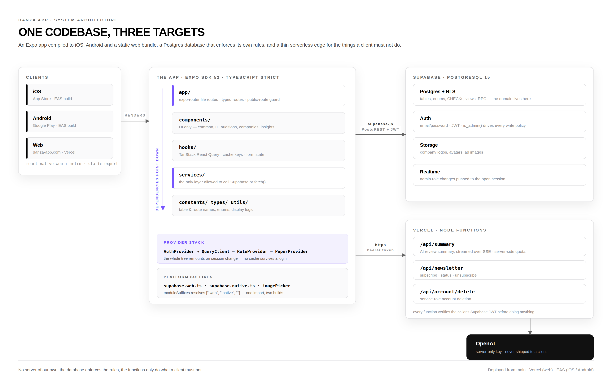
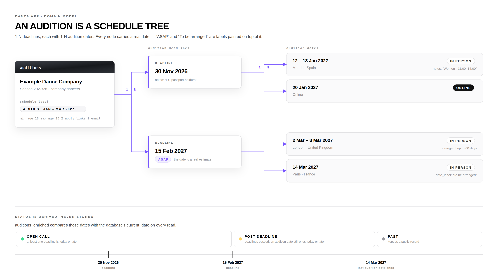
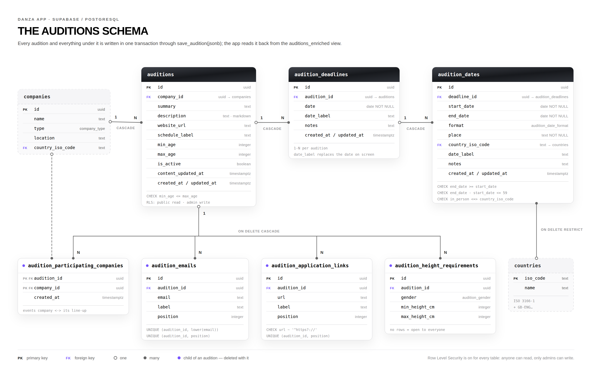
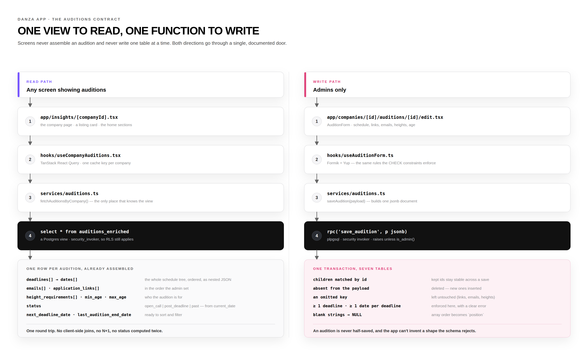

<div align="center">

# Danza App

**The audition board for professional dance.**
Companies, open calls and first-hand reviews — in one place, on iOS, Android and the web.

[danza-app.com](https://danza-app.com)


</div>

---

## Why it exists

Audition information is scattered: an Instagram story that expires, a PDF in a WhatsApp group, a deadline buried in a company's news page. Dancers plan a career around dates they can barely find, and almost never get to hear what working at a company is actually like before they sign.

Danza App turns that noise into structured, queryable data: every company, every open call, every deadline and city — plus reviews written by the dancers who were there.

## What the platform does

| | |
|---|---|
| **Company directory** | Dance companies, professional schools and festivals, each with location, links, rating and verification state. |
| **Auditions** | Open calls attached to the company that runs them, with a real schedule: deadlines, cities, dates, formats, apply links, contact emails, age and height requirements. |
| **Reviews** | First-hand accounts from dancers, with visibility controls and moderation. |
| **AI summaries** | Once a company has enough reviews, an OpenAI-generated summary streams in over SSE, behind a server-side per-user quota. |
| **Events & line-ups** | A festival or gala is a company too: it can run an audition that other companies take part in, and each participant's page says so while the call is live. |
| **Favourites, newsletter, ads** | Saved companies, a newsletter with its own subscribe/unsubscribe endpoints, and a rotating ad carousel. |
| **Admin surface** | The whole catalogue is editable in-app by admins — no separate CMS, no SQL console. |

---

## Architecture

One Expo codebase compiles to three targets. There is no backend of our own: Postgres holds the domain and enforces it, and a handful of Vercel functions cover the few things a client must not be trusted with.



**The rules that shape the code**

- **UI never touches the network.** Components render, `hooks/` own state and caching, `services/` are the only modules importing the Supabase client or calling `fetch`. That is what keeps `supabase.web.ts` and `supabase.native.ts` interchangeable and the screens testable.
- **One import, two builds.** TypeScript `moduleSuffixes: [".web", ".native", ""]` resolves platform variants at compile time — storage persistence, image pickers, file downloads and the landing globe all differ per platform without a single `Platform.OS` branch in a screen.
- **No magic strings.** Table and view names, RPC names, route paths, storage keys, status values and breakpoints live in `constants/` and `types/` as `as const` objects with derived unions, so a rename is a compiler error rather than a runtime surprise.
- **The session is the cache boundary.** The whole provider tree is keyed on the user id, so signing in or out remounts it with a fresh `QueryClient`. No data from one account can survive into the next.
- **Secrets stay server-side.** `EXPO_PUBLIC_*` is everything the client is allowed to know; the OpenAI key and the service role key only ever exist inside a Vercel function.

---

## The domain: an audition is a schedule tree

This is the part of the model worth understanding. An audition used to describe its dates with *modes* — fixed date / ASAP / always open, single date / to be arranged / various dates — plus a free-text note and a JSON blob. Half the rows carried no usable date, so status and filters were guesswork.

It is now a tree. An audition has **1-N deadlines**, each deadline has **1-N audition dates** (a range of up to 60 days, in one place, in person or online). Every node carries a real date; `"ASAP"` and `"To be arranged upon invitation"` survive only as display labels painted on top of it.



Because every node has a date, **status is derived, never stored**: `open_call`, `post_deadline` and `past` fall out of comparing those dates with the database's `current_date` on every read. Nothing to backfill, nothing to keep in sync, no cron job marking auditions as expired.

The reasoning, the options rejected and the migration path are in [`docs/adr/0001-audition-schedule-tree.md`](docs/adr/0001-audition-schedule-tree.md); the vocabulary is in [`GLOSSARY.md`](GLOSSARY.md).

### The schema



What the database guarantees on its own, without help from the app:

- **Enums, not free text.** `audition_status`, `audition_date_format`, `audition_gender`, `company_type` are Postgres enums mirroring the TypeScript unions one-for-one.
- **CHECK constraints carry the business rules.** An audition date cannot end before it starts or span more than 60 days; an in-person date must have a country and an online one must not; apply links must be `http(s)`; `min_age <= max_age`; labels can't be blank strings.
- **Deliberate `ON DELETE` everywhere.** Deleting an audition cascades to its deadlines, dates, emails, links, heights and line-up. Deleting a country is `RESTRICT` — you can't orphan a date's location.
- **RLS on every table.** Anyone may read; only `is_admin()` may write. There is no "trusted client" path.
- **Ordering is data.** Emails and apply links carry a `position` with a unique constraint per audition, so the order an admin chose is the order every platform renders.
- **Indexes where the app actually looks** — every foreign key, plus the deadline and audition dates that status and filters sort on.

### Reading and writing one



Seven tables would normally mean seven queries, or a pile of client-side joins that drift between the listing card, the company page and the admin form. Instead there is exactly one door in each direction:

- **Read: `auditions_enriched`.** A `security_invoker` view that returns one fully-assembled row per audition — the schedule tree as nested, ordered JSON, plus emails, apply links, height requirements, the derived status and the sort keys. One round trip, no N+1, and every screen agrees on what an audition is because they all read the same shape.
- **Write: `save_audition(p jsonb)`.** One plpgsql function, one transaction, the whole tree. Children are matched by id so kept rows stay stable, new ones are inserted, anything absent is deleted, and an omitted key leaves that collection untouched. It refuses to save an audition with no deadline or a deadline with no date, and it runs `security invoker` so RLS still applies to the admin calling it.

An audition is therefore never half-saved, and the app cannot persist a shape the schema would reject.

---

## Repository map

```
app/            expo-router file routes — screens only
components/     presentation: common/, ui/, auditions/, companies/, insights/, landing/…
hooks/          React Query hooks, form state, derived view state
services/       the only layer that talks to Supabase, OpenAI or the API routes
providers/      AuthProvider (session) and RoleProvider (admin, live over Realtime)
constants/      table & view names, RPC names, routes, enums, layout breakpoints
types/          domain types mirroring the Postgres enums and view shapes
utils/          pure logic: status display, schedule formatting, validation, flags
theme/          design tokens: palette, gradients, Inter type scale, layout helpers
api/            Vercel Node functions (summary SSE, newsletter, account deletion)
supabase/       tracked SQL migrations — the schema's only source of truth
docs/           architecture decision records and the diagrams above
```

## Engineering standards

The house rules, enforced in review and written down in [`CLAUDE.md`](CLAUDE.md):

- **SOLID, applied to a React codebase.** A component renders, a hook fetches, a service integrates. Variants extend through props and composition, never through an `if (specialCase)` inside a shared component. Prop types stay narrow — a card that needs a name and a logo takes a name and a logo, not the whole entity.
- **DRY by search-first.** Before new logic is written, `hooks/`, `services/`, `utils/` and `components/common` get searched. Anything duplicated twice becomes a shared hook, service or util.
- **The schema is the domain model.** `snake_case`, pluralised tables, junction tables named after both sides, normalised unless a view is deliberately built for read performance and documented as such. Every mutable table has `created_at` / `updated_at` via trigger.
- **Migrations only.** Schema changes ship as tracked SQL under `supabase/migrations` — never as dashboard edits — so the history is reproducible and reviewable. Breaking changes roll out expand → migrate → contract, because the app and its preview deployments share one production database.
- **Tests where logic lives.** Jest + `jest-expo` cover the pure layers: schedule formatting, validation, form mapping, listing and stats derivation.

## Delivery

| Target | Pipeline |
|---|---|
| **Web** | `expo export --platform web` → static bundle on Vercel, production from `main`, previews per branch. |
| **iOS / Android** | EAS Build → App Store and Google Play (`com.danzaapp.mobile`). |
| **Database** | Supabase CLI migrations applied to the production project. |
| **Functions** | Deployed alongside the web build as Vercel Node functions under `/api`. |

---

<div align="center">

**Danza App** · built for the dance community.
Suggestions, corrections or collaboration: open an issue.

</div>
